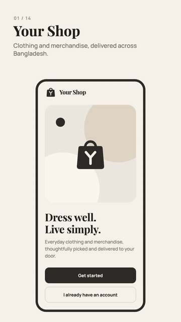
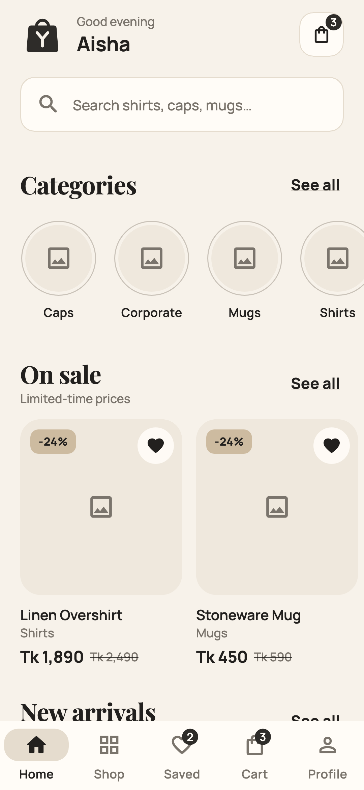
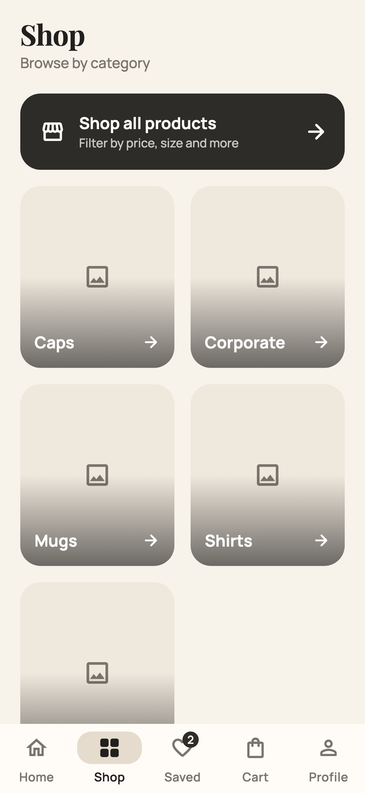
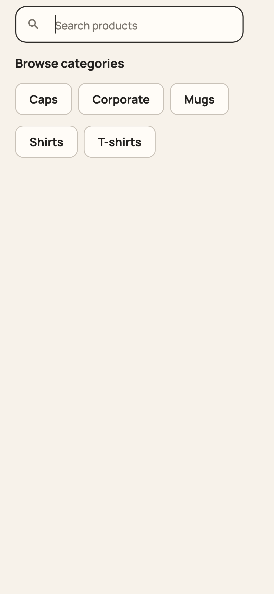
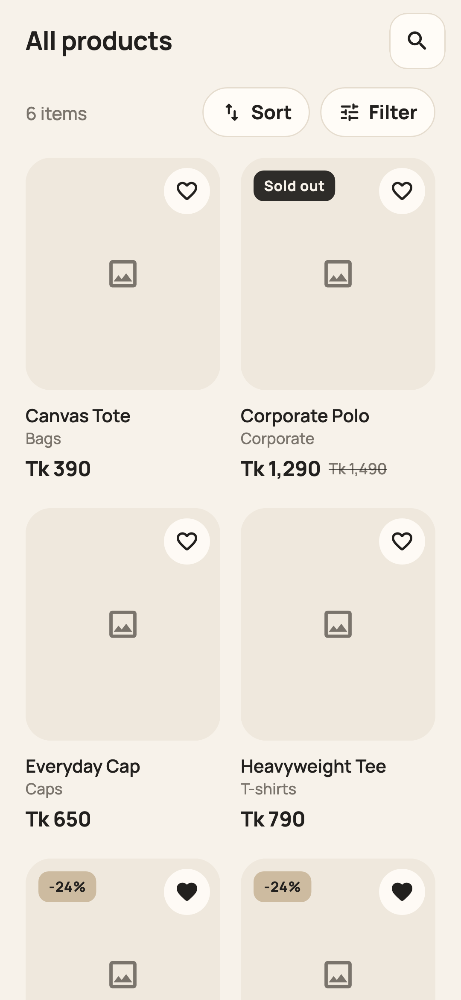
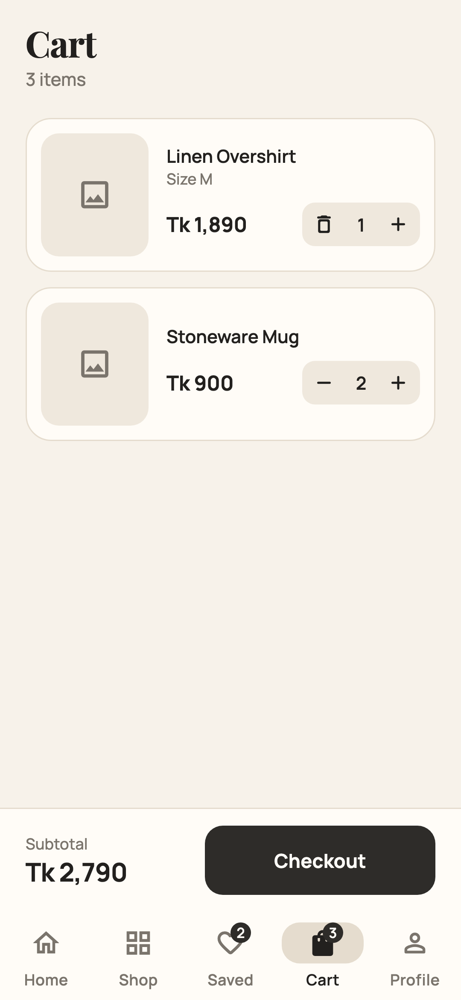
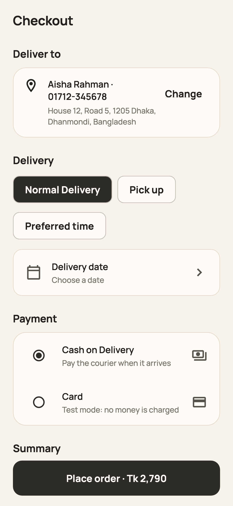
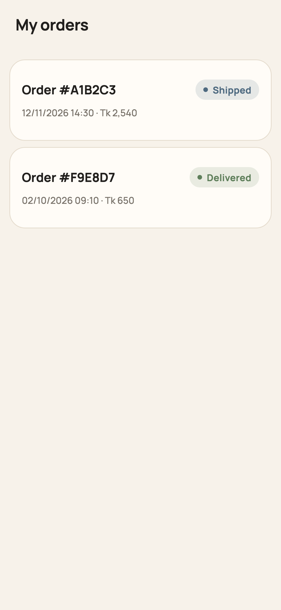
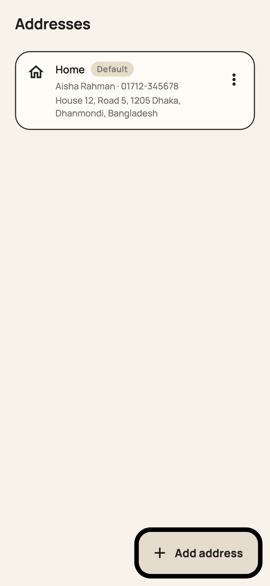
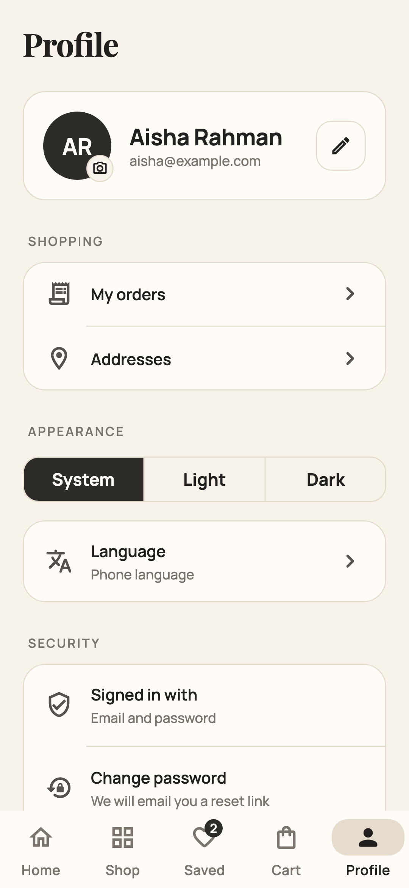

# Your Shop

An online shop for clothing and merchandise in Bangladesh, built with Flutter and Firebase. Customers browse the catalogue, pay in Taka by cash on delivery or card, and follow their orders live.

<p align="center">
  
</p>
<p align="center"><a href="docs/media/app-tour.mp4">▶ Watch the full app tour (MP4, 37 s)</a></p>

> **Status:** moving from a university project to a Google Play release. See [docs/ROADMAP.md](docs/ROADMAP.md) for the sprint plan.

## Features

**Shopping**
- Catalogue with categories, filters (price, size, stock, discount), sorting and typo-tolerant ranked search
- Product pages with a zoomable gallery, sizes, live stock and related products
- Cart and saved items synced to the account, checked against live prices and stock, and usable offline
- Prices in Bangladeshi Taka (`Tk 1,290`)

**Checkout and orders**
- Address book with a default address
- Cash on delivery or card. Card payments go through Stripe and Cloud Functions; a test gateway is used until those are deployed.
- The order is created first, so stock is reserved and the cart emptied in one step. Unpaid card orders are released after 30 minutes.
- Live order history with a status timeline, pay-again, cancellation and refunds
- Push notifications when an order's status changes

**Account**
- Email and password or Google sign-in, with email verification and password reset
- Optional biometric app lock
- Profile photo, light and dark themes, and English or Bahasa Melayu
- Privacy policy and terms in the app, and account deletion as Google Play requires
- Offline banner and support for large text

## Screenshots

| Welcome | Home | Categories | Product |
|:-:|:-:|:-:|:-:|
|  |  |  |  |
| **Search** | **Filters** | **Cart** | **Checkout** |
|  |  |  |  |
| **Orders** | **Addresses** | **Profile** | **Dark mode** |
|  |  |  |  |

The screenshots are the real screens rendered with sample data, which is why product photos show placeholders.

## Tech stack

| Layer | Choice |
|-------|--------|
| UI | Flutter (Material 3), custom grey and cream design system, light and dark themes |
| Architecture | MVVM: `data/` holds models and repositories, `*ViewModel` classes are GetX controllers, views are `GetView` widgets |
| State, DI, routing, i18n | GetX |
| Backend | Firebase Auth, Cloud Firestore, Storage, Cloud Messaging; Cloud Functions (TypeScript) |
| Payments | Pluggable `PaymentGateway`: Stripe or the test gateway now, with room for bKash and SSLCommerz |
| Security | `firestore.rules` and `storage.rules`. Orders, stock and payments change only on the server. |

```
lib/
  app/        routes, bindings, middleware
  core/       config, services, theme, i18n, shared widgets
  data/       models, repositories, catalogue cache
  modules/    one folder per feature: view_models/, views/, bindings/
functions/    Cloud Functions (payments, orders, account deletion, push)
test/         unit, widget, flow and security-rules tests
tool/         screenshot harness, app-tour video, brand assets, CI helpers
```

## Getting started

Requirements: Flutter stable 3.47 or later, JDK 17 or later, and Android SDK 36.

```sh
git clone https://github.com/sbfrusho/UTM_clothing_app.git
cd UTM_clothing_app
flutter pub get
cp env/example.json env/dev.json   # then fill in values as needed
flutter run --dart-define-from-file=env/dev.json
```

In VS Code, choose the **Your Shop (dev)** launch configuration.

### Firebase
The Android package is `com.sbfrusho.yourshop`. Register it in the Firebase console (project `nabilrayhanshopping`) together with your SHA-1, then download `google-services.json` into `android/app/`. You can also run `flutterfire configure`. Until it is registered, the Android build fails with *"No matching client found for package name"*.

### Environment values (`env/*.json`)
| Key | Purpose |
|-----|---------|
| `APP_ENV` | `dev`, `staging` or `prod` |
| `CURRENCY` / `CURRENCY_SYMBOL` | Pricing currency, default `BDT` / `Tk` |
| `FUNCTIONS_BASE_URL` | Deployed Cloud Functions, e.g. `https://asia-southeast1-<project>.cloudfunctions.net`. Required once the security rules are deployed. |
| `STRIPE_PUBLISHABLE_KEY` | Stripe `pk_...` key (publishable only) |
| `GOOGLE_SERVER_CLIENT_ID` | Firebase OAuth **Web** client ID. Leave empty to hide Google sign-in. |
| `SUPPORT_EMAIL` | Contact address shown in the privacy policy and terms |
| `PRIVACY_POLICY_URL` / `TERMS_URL` | Hosted copies of [docs/PRIVACY_POLICY.md](docs/PRIVACY_POLICY.md) and [docs/TERMS.md](docs/TERMS.md) |
| `SUPPORT_WHATSAPP` | WhatsApp number for "Contact us". Leave empty to hide it. |

Without `STRIPE_PUBLISHABLE_KEY` and `FUNCTIONS_BASE_URL`, card payments use the **test gateway**, which charges nothing.

> **Never put secret keys** (Stripe `sk_...`, SMTP passwords, service accounts) in the app or in `env/`. Anything compiled into an APK can be extracted. Secrets belong in Cloud Functions.

## Testing

```sh
flutter analyze
flutter test                                   # unit, widget and purchase-flow tests
cd functions && npm test                       # Cloud Functions
cd test/firestore_rules && npm ci && npx firebase emulators:exec \
  --only firestore --project demo-your-shop --config ../../firebase.json \
  "node --test rules.test.mjs"                 # security rules (needs Java)
```

GitHub Actions ([.github/workflows/ci.yml](.github/workflows/ci.yml)) runs all of these on every pull request and also builds a release app bundle.

## Screenshots and app tour

```sh
flutter test tool/screenshots_test.dart --update-goldens        # tool/screenshots/*.png
cp tool/screenshots/*.png docs/screenshots/
flutter test tool/app_tour/slides_test.dart --update-goldens    # captioned slides
sh tool/app_tour/make_video.sh                                  # docs/media/app-tour.mp4 and .gif (needs ffmpeg)
```

## Brand assets
The logo is vector code in `lib/core/widgets/brand/brand_mark_painter.dart`. After changing it, run:
```sh
flutter test tool/generate_brand_assets_test.dart   # renders assets/branding/*.png
dart run flutter_launcher_icons                      # launcher and adaptive icons
dart run flutter_native_splash:create                # native splash
```
Fonts: Manrope and Playfair Display (SIL OFL), bundled in `assets/fonts`.

## Documentation
- [Backend and deployment](docs/BACKEND.md)
- [Release to Google Play](docs/RELEASE.md)
- [Roadmap](docs/ROADMAP.md)
- [Privacy policy](docs/PRIVACY_POLICY.md) and [terms](docs/TERMS.md)

## Author
Developed by **Sakib Bin Faruque Rusho**: [rushocseru28@gmail.com](mailto:rushocseru28@gmail.com) · [GitHub](https://github.com/sbfrusho)
