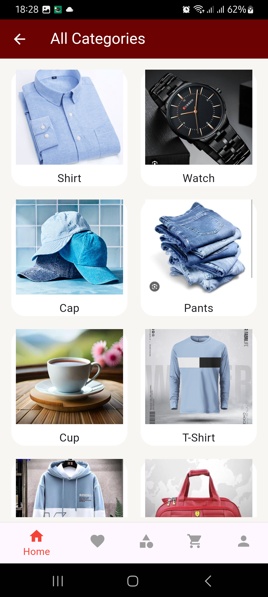
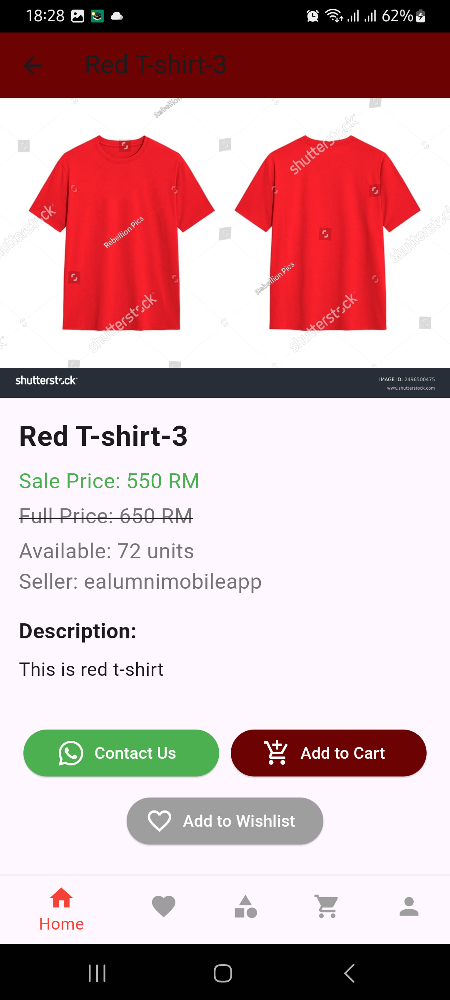
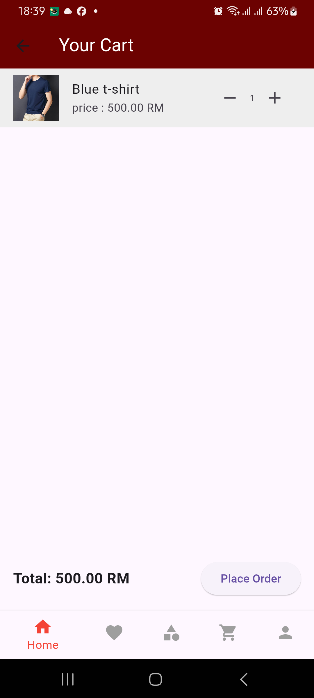

# Your Shop

A Flutter e-commerce app for clothing and merchandise, built on Firebase with GetX for state management, dependency injection and routing.

> Status: being moved from a university project to a production Play Store release. See [docs/ROADMAP.md](docs/ROADMAP.md) for the sprint plan.

## Features
- Email/password authentication with email verification and password reset
- Optional biometric app lock (fingerprint / Face ID)
- Product catalogue by category, search and product details
- Cart and wishlist
- Checkout with Cash on Delivery or card (test-mode gateway)
- Order history

## Tech stack
| Layer | Choice |
|-------|--------|
| UI | Flutter (Material 3) |
| Architecture | MVVM (`data/` = Model, `*ViewModel` = GetX controllers, `GetView` views) |
| State, DI, routing | GetX |
| Backend | Firebase Auth, Cloud Firestore, Cloud Messaging |
| Payments | Pluggable `PaymentGateway`: demo gateway now; Stripe, bKash or SSLCommerz through a server backend |

## Screenshots
<p>
  
  
  
  
</p>

## Getting started

Requirements: Flutter stable (3.47 or later), JDK 17 or later, Android SDK 36.

```sh
git clone https://github.com/sbfrusho/UTM_clothing_app.git
cd UTM_clothing_app
flutter pub get
cp env/example.json env/dev.json   # then fill in values if needed
flutter run --dart-define-from-file=env/dev.json
```

In VS Code, choose the **Your Shop (dev)** launch configuration.

### Environment values (`env/*.json`)
| Key | Purpose |
|-----|---------|
| `APP_ENV` | `dev`, `staging` or `prod` |
| `CURRENCY` / `CURRENCY_SYMBOL` | Pricing currency, e.g. `MYR` / `RM` |
| `STRIPE_PUBLISHABLE_KEY` | Stripe `pk_...` key (publishable only) |
| `PAYMENT_BACKEND_URL` | Server endpoint that creates PaymentIntents |

If `STRIPE_PUBLISHABLE_KEY` or `PAYMENT_BACKEND_URL` is empty, card payments use the **demo gateway**: a simulated payment that charges nothing.

> **Never put secret keys** (Stripe `sk_...`, SMTP passwords, service accounts) in the app or in `env/`. Anything compiled into an APK can be extracted. Secrets belong in Cloud Functions.

### Firebase
The Android app ID is `com.sbfrusho.yourshop`. Register it in the Firebase console, then download `google-services.json` into `android/app/` (or run `flutterfire configure`).

## Testing
```sh
flutter analyze
flutter test
```

## Release
See [docs/RELEASE.md](docs/RELEASE.md).

## Author
Developed by **Sakib Bin Faruque Rusho**: [rushocseru28@gmail.com](mailto:rushocseru28@gmail.com) · [GitHub](https://github.com/sbfrusho)
